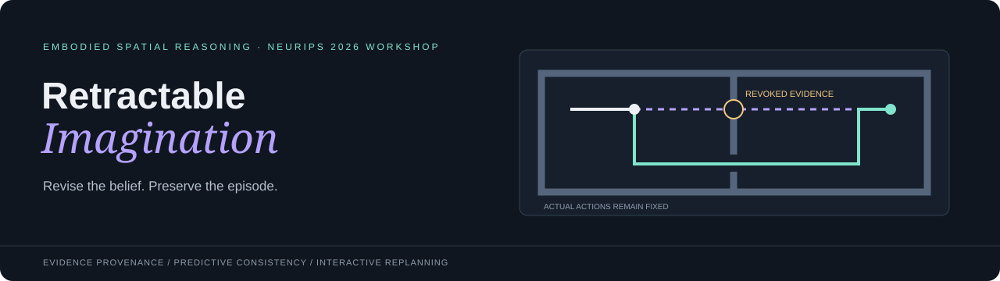
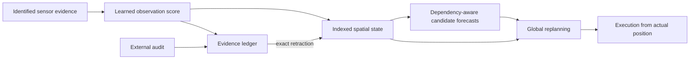

<p align="center"></p>

<p align="center"><strong>Evidence-addressable spatial prediction for interactive replanning</strong><br>Vaibhav Kanojia<br>Research demo for the 2nd Workshop on Embodied Spatial Reasoning · NeurIPS 2026</p>

<p align="center"><a href="paper_latex/main.pdf"><strong>Paper PDF</strong></a> · <a href="paper_latex"><strong>LaTeX source</strong></a> · <a href="offline_demo.html"><strong>Offline artifact</strong></a> · <a href="docs/EVALUATION.md"><strong>Evaluation protocol</strong></a> · <a href="results/study.json"><strong>Measured results</strong></a></p>

An agent has already acted on a faulty observation. When that evidence is revoked, which beliefs and imagined futures must change—and which should remain?

**Retractable Imagination** connects a learned sensor encoder, an evidence-indexed spatial state, dependency-aware forecast caching, and replanning from the agent's actual position. Evidence can be removed; realized actions and their physical consequences remain.

This repository accompanies a demo-paper manuscript for the [Embodied Spatial Reasoning workshop](https://embodiedsr.github.io/). It does not imply acceptance or an award.

## Try the demonstration

1. Download the repository ZIP or clone it.
2. Open **`offline_demo.html`** in a desktop browser. No account, API key, Python environment, GPU, or internet connection is required for the interaction.
3. Inspect the invalid camera-B packet **E006**. The white trajectory contains five actions already executed.
4. Select **Retract invalid evidence**. The occupancy estimate changes, one candidate forecast is invalidated, and a new route is planned from the current position.
5. Select **Execute plan**. The agent follows the lower passage. Toggle the evaluator-only truth overlay or reset and try execution without correction.

The inference and planning are live. Training and evaluation panels display the saved measurements supplied with the code. GitHub displays HTML source; download the file or clone the repository to run the offline artifact.

For a local server:

```sh
python serve.py --port 8765
```

Open `http://127.0.0.1:8765`.

## System



The observation encoder is learned from synthetic detector features. **The retraction operator is exact additive inference, not a learned inverse of arbitrary neural memory.** An explicit sufficient-statistic implementation performs the same correction. This distinction is central to interpreting the paper.

## Results at a glance

The expanded study contains **480 seeded episodes**, with randomized room dimensions, passage coordinates, observation strengths and background measurements. Each family has 120 episodes.

| Task family | Stale belief | Stale forecast after state repair | Full replay | Indexed retraction |
|---|---:|---:|---:|---:|
| False free space | 0/120 | 0/120 | 120/120 | 120/120 |
| False obstacle | 120/120 | 120/120 | 120/120 | 120/120 |
| Source packet group | 0/120 | 0/120 | 120/120 | 120/120 |
| No corruption | 120/120 | 120/120 | 120/120 | 120/120 |

- **Consistency:** maximum state discrepancy against corrected-history replay is `4.44e-16` log-odds; unaffected factors have zero measured drift.
- **Action cost:** in false-obstacle episodes, correction reduces median remaining route length from **39 to 23** grid steps while both policies still reach the goal.
- **Explicit control:** checkpoint replay and explicit subtraction match all corrected decisions. These results do not establish superiority among exact correction methods.
- **Backend timing:** revision, 20 route forecasts and global A* are measured together across 24 independent histories per condition. Raw samples, seeds and timing scope are included.

These are controlled passage-task samplers with supplied audit IDs and structural maps, not a real-world deployment success estimate. Read the [evaluation contract](docs/EVALUATION.md) before interpreting the percentages.

## Reproduce the study

Python 3.10+ is supported. Node.js is needed only for the JavaScript parity test. The interactive artifact itself has no dependencies.

```sh
python -m pip install -r requirements.txt
python evaluate.py
python study.py
python -m unittest test_engine
node test_core.js
```

Evaluation overwrites the local measured JSON. Regenerate the paper assets and rebuild afterward to keep the PDF synchronized:

```sh
python paper_latex/scripts/generate_assets.py
python build_paper.py
python package_demo.py
```

The paper builds with **pdflatex → BibTeX → pdflatex → pdflatex**. A standard MiKTeX or TeX Live installation is required. On Windows, `paper_latex/build.cmd` provides the same sequence without requiring Perl. See [paper build instructions](paper_latex/README.md).

## Repository layout

```text
engine.py              Sensor encoder, retractable state, forecasts, planner
evaluate.py            Sensor fit and exact-state/cache controls
study.py               Expanded task study and backend timings
test_engine.py         Inference and ledger correctness tests
test_core.js           JavaScript parity and route checks
web/                   Interactive interface and JavaScript core
offline_demo.html      Self-contained demonstration
results/               Raw measurements and per-episode records
paper_latex/           Official NeurIPS style, sources, figures, tables, PDF
docs/EVALUATION.md     Protocol, timing scope and limitations
```

## Paper and scope

**Retractable Imagination: Evidence-Addressable Spatial Prediction for Interactive Replanning**<br>
**Vaibhav Kanojia**

The manuscript uses the unmodified official NeurIPS 2026 style. The named working copy uses its single-blind workshop option; confirm the organizer's anonymity and length requirements before submission.

The system assumes static independent occupancy factors and externally identified invalid packets. It does not claim autonomous corruption discovery, arbitrary recurrent-state unlearning, physical-robot validation, or a general physics-compliant video model. A learned non-additive revision operator remains a research extension, not a reported result.

## Citation

Use GitHub's **Cite this repository** action or the accompanying `CITATION.cff`. The manuscript and software have one author: **Vaibhav Kanojia**.
